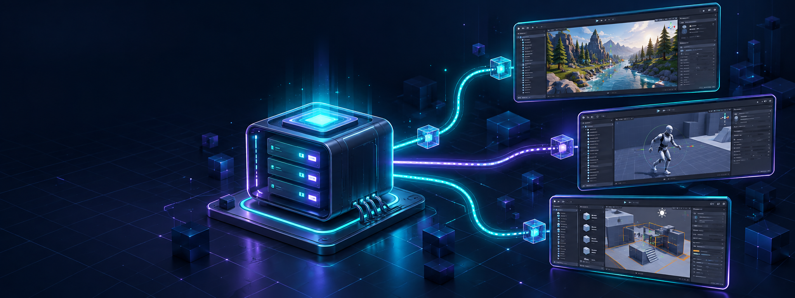

# Unity MCP Hub

**1つのローカル MCP エンドポイントから、複数の Unity Editor へ。** 公式の [Coplay MCP for Unity](https://github.com/CoplayDev/unity-mcp) を通じて、Codex などの MCP クライアントを実行中の Unity プロジェクトに接続します。

[English](README.md) · [简体中文](README.zh-CN.md) · [日本語](README.ja.md)



> この画像は機能を表すイラストであり、アプリのスクリーンショットではありません。

## 主な特長

- **共通の接続先：** MCP クライアントには `http://127.0.0.1:9000/mcp` を設定するだけです。
- **複数プロジェクト：** 実行中の Unity Editor を検出し、必要なプロジェクトを接続できます。アクティブな Editor は Coplay が MCP クライアントのセッションごとに管理します。
- **元に戻せる接続：** ローカル UPM パッケージ参照を一時的に追加し、切断時に `manifest.json` と `packages-lock.json` の元の状態を復元します。異常終了後の復旧記録も備えています。
- **Coplay のツールを利用：** Unity のツール、ツール検出、インスタンスの切り替えは Coplay が担当し、Hub はローカル接続のライフサイクルを管理します。
- **オフライン配布：** Windows x64 向けパッケージには .NET、Python、Coplay サーバー、Unity パッケージを同梱できます。

## クイックスタート

### Windows オフラインパッケージ

[Releases](https://github.com/TristinOrg/Unity-MCP-Hub/releases) に Windows x64 ZIP がある場合は、ダウンロードして展開し、`UnityMCPHub.exe` を実行してください。オフラインパッケージの利用者は .NET、Python、`uv`、Git を別途インストールする必要がありません。

### ソースから実行

Windows、.NET 8 SDK、Unity 2021.3 以降、および `uvx` が `PATH` にある [uv](https://docs.astral.sh/uv/) が必要です。

```powershell
dotnet run --project src/Tristin.MCPManager.UI
```

1. Unity プロジェクトを1つ以上開きます。
2. Hub でプロジェクトを選んで **Connect** をクリックします。他のプロジェクトも同様に接続します。
3. 画面の **Copy** で MCP 接続先をコピーし、クライアントに設定します。

```toml
[mcp_servers.unity_hub]
url = "http://127.0.0.1:9000/mcp"
enabled = true
```

4. 複数の Editor を接続した場合、`mcpforunity://instances` を読み取り、変更操作の前に**各** MCP クライアントのセッションで Coplay の `set_active_instance` を呼び出してください。

JSON 設定、複数インスタンスの切り替え、手動 HTTP 呼び出しの例は [AI Agent Guide](MCP_AGENT_GUIDE.md) を参照してください。

## 仕組み

```text
Codex / MCP クライアント → 127.0.0.1:9000/mcp → Unity MCP Hub
                                                  ↓ 透過プロキシ
                                     Coplay サーバー (127.0.0.1:8080)
                                                  ↓
                                        Unity Editor A · B · C
```

Hub は現在 Windows 専用で、公開 MCP エンドポイントはローカルホストにバインドされます。Coplay 10.1.0 の Unity パッケージと対応するサーバーを使用します。同じクライアントに Hub の 9000 番ポートと Coplay 内部の 8080 番ポートを同時に設定すると、Unity ツールが重複します。

## ビルドとパッケージ作成

```powershell
dotnet test Tristin.MCPManager.sln
dotnet build Tristin.MCPManager.sln --configuration Release
pwsh ./tools/build-offline.ps1
pwsh ./tools/test-offline.ps1
```

オフラインパッケージの作成前に、Hub から Unity プロジェクトを一度接続して Coplay Unity パッケージをキャッシュしてください。ZIP と SHA-256 ファイルは `artifacts/` に生成されます。

## 開発状況と参加方法

実装済みの機能と今後の予定は [ROADMAP.md](ROADMAP.md) をご覧ください。[Issues](https://github.com/TristinOrg/Unity-MCP-Hub/issues) での不具合報告、使い勝手や翻訳への提案、PR を歓迎します。役に立った場合は Star を付けていただけると、ほかの Unity 開発者にも見つけてもらいやすくなります。

## ライセンス

MIT。Coplay MCP for Unity は Coplay が別途保守し、同リポジトリのライセンスで提供しています。Unity は Unity Technologies の商標であり、本プロジェクトは Unity Technologies と提携していません。
