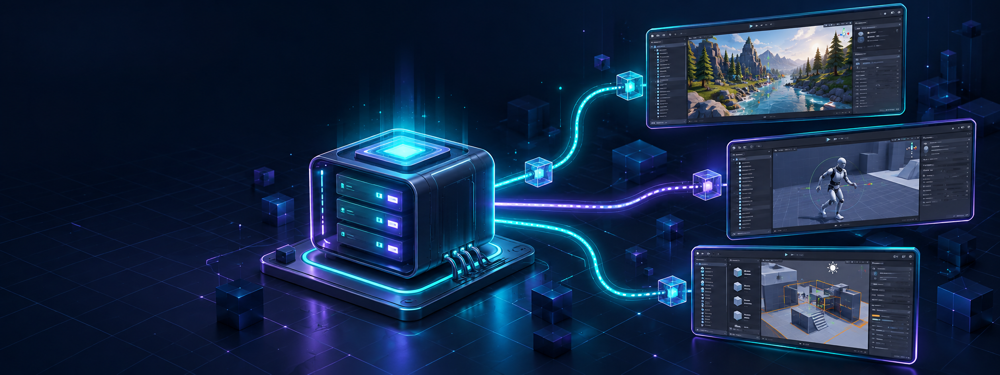

# Unity MCP Hub

**One local MCP endpoint for multiple Unity Editors.** Connect your open Unity projects to Codex or another MCP client through the official [Coplay MCP for Unity](https://github.com/CoplayDev/unity-mcp).

[English](README.md) · [简体中文](README.zh-CN.md) · [日本語](README.ja.md)



> The banner is a conceptual illustration, not a screenshot of the application.

## Why use it?

- **One address:** point your MCP client to `http://127.0.0.1:9000/mcp`.
- **Multiple projects:** discover running Unity Editors and connect the projects you need. Coplay selects the active Editor per MCP client session.
- **Reversible connection:** the Hub injects a local UPM package reference and restores the original `manifest.json` and `packages-lock.json` state on disconnect. A recovery journal handles an unclean shutdown.
- **Use Coplay's tools:** Unity commands, tool discovery, and routing are supplied by Coplay; this app manages the local connection lifecycle.
- **Offline distribution:** a Windows x64 package can include the .NET and Python runtimes, the pinned Coplay server, and its Unity package.

## Get started

### Windows offline package

Download a Windows x64 ZIP from [Releases](https://github.com/TristinOrg/Unity-MCP-Hub/releases) when available, extract it, and run `UnityMCPHub.exe`. The offline package does not require end users to install .NET, Python, `uv`, or Git.

### Run from source

Requirements: Windows, .NET 8 SDK, Unity 2021.3+, and [uv](https://docs.astral.sh/uv/) with `uvx` on `PATH`.

```powershell
dotnet run --project src/Tristin.MCPManager.UI
```

1. Open one or more Unity projects.
2. In the Hub, select a project and click **Connect**. Repeat for other projects.
3. Copy the MCP endpoint from the app and add it to your client:

```toml
[mcp_servers.unity_hub]
url = "http://127.0.0.1:9000/mcp"
enabled = true
```

4. When multiple Editors are connected, read `mcpforunity://instances` and call Coplay's `set_active_instance` in **each** MCP client session before changing a project.

See the [AI Agent Guide](MCP_AGENT_GUIDE.md) for JSON configuration, multi-instance routing, and a manual HTTP example.

## How it works

```text
Codex / MCP client → 127.0.0.1:9000/mcp → Unity MCP Hub
                                            ↓ transparent proxy
                              Coplay server on 127.0.0.1:8080
                                            ↓
                               Unity Editor A · B · C
```

The Hub is Windows-specific and binds its public endpoint to localhost. It uses a pinned Coplay 10.1.0 package and matching server. Do not configure both the Hub's port 9000 and Coplay's internal port 8080 in the same client; that duplicates the Unity tool list.

## Build and package

```powershell
dotnet test Tristin.MCPManager.sln
dotnet build Tristin.MCPManager.sln --configuration Release
pwsh ./tools/build-offline.ps1
pwsh ./tools/test-offline.ps1
```

The offline build requires the Coplay package to be cached by connecting one Unity project first. The build script creates a ZIP and SHA-256 file in `artifacts/`.

## Project status and contributing

See [ROADMAP.md](ROADMAP.md) for implemented features and planned work. Bug reports, usability feedback, translations, and pull requests are welcome through [Issues](https://github.com/TristinOrg/Unity-MCP-Hub/issues). If this tool helps your Unity workflow, a GitHub star helps others find it.

## License

MIT. Coplay MCP for Unity is maintained and licensed separately by Coplay. Unity is a trademark of Unity Technologies; this project is not affiliated with Unity Technologies.
