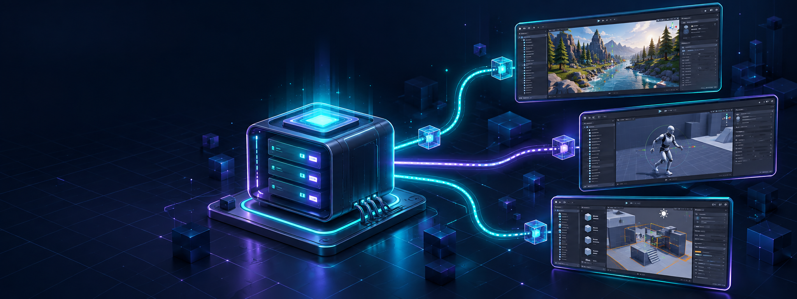

# Unity MCP Hub

**一个本地 MCP 地址，连接多个 Unity Editor。** 通过官方 [Coplay MCP for Unity](https://github.com/CoplayDev/unity-mcp)，让 Codex 等 MCP 客户端访问正在运行的 Unity 项目。

[English](README.md) · [简体中文](README.zh-CN.md) · [日本語](README.ja.md)



> 上图是功能概念图，不是软件界面截图。

## 为什么使用

- **统一入口：** MCP 客户端只需配置 `http://127.0.0.1:9000/mcp`。
- **多项目连接：** 自动发现运行中的 Unity Editor，按需连接项目；Coplay 为每个 MCP 客户端会话分别选择当前 Editor。
- **可恢复的接入方式：** Hub 临时注入本地 UPM 包引用，断开时恢复原有的 `manifest.json` 和 `packages-lock.json` 状态；异常退出后可通过恢复记录处理未完成的注入。
- **沿用 Coplay 工具：** Unity 工具、工具发现和实例路由由 Coplay 提供，Hub 负责本地连接生命周期。
- **离线分发：** Windows x64 离线包可包含 .NET、Python、Coplay 服务端和 Unity 包。

## 快速开始

### 使用 Windows 离线包

如 [Releases](https://github.com/TristinOrg/Unity-MCP-Hub/releases) 页面提供 Windows x64 ZIP，下载并解压后运行 `UnityMCPHub.exe`。离线包用户无需单独安装 .NET、Python、`uv` 或 Git。

### 从源码运行

需要 Windows、.NET 8 SDK、Unity 2021.3 或更新版本，以及已将 `uvx` 加入 `PATH` 的 [uv](https://docs.astral.sh/uv/)。

```powershell
dotnet run --project src/Tristin.MCPManager.UI
```

1. 打开一个或多个 Unity 项目。
2. 在 Hub 中选择项目并点击 **Connect**；其他项目重复此操作。
3. 点击界面的 **Copy**，把 MCP 地址配置到客户端：

```toml
[mcp_servers.unity_hub]
url = "http://127.0.0.1:9000/mcp"
enabled = true
```

4. 连接多个 Editor 时，先读取 `mcpforunity://instances`，再在**每个** MCP 客户端会话中调用 Coplay 的 `set_active_instance`，然后操作目标项目。

JSON 配置、多实例路由和手动 HTTP 调用示例见 [AI Agent Guide](MCP_AGENT_GUIDE.md)。

## 工作原理

```text
Codex / MCP 客户端 → 127.0.0.1:9000/mcp → Unity MCP Hub
                                             ↓ 透明代理
                               127.0.0.1:8080 的 Coplay 服务
                                             ↓
                                  Unity Editor A · B · C
```

Hub 目前仅支持 Windows，公开的 MCP 地址绑定在本机回环接口。项目固定使用 Coplay 10.1.0 的 Unity 包和对应服务端。不要在同一个客户端同时配置 Hub 的 9000 端口和 Coplay 内部的 8080 端口，否则会出现重复的 Unity 工具。

## 构建与打包

```powershell
dotnet test Tristin.MCPManager.sln
dotnet build Tristin.MCPManager.sln --configuration Release
pwsh ./tools/build-offline.ps1
pwsh ./tools/test-offline.ps1
```

首次构建离线包前，需通过 Hub 连接一次 Unity 项目，以缓存 Coplay Unity 包。脚本会在 `artifacts/` 生成 ZIP 和 SHA-256 文件。

## 路线图与参与

已实现功能和计划见 [ROADMAP.md](ROADMAP.md)。欢迎通过 [Issues](https://github.com/TristinOrg/Unity-MCP-Hub/issues) 反馈问题、改进体验或参与翻译，也欢迎提交 PR。如果这个项目对你有帮助，给仓库点一个 Star 能让更多 Unity 开发者发现它。

## 许可证

本项目采用 MIT 许可证。Coplay MCP for Unity 由 Coplay 独立维护并按其仓库许可证发布。Unity 是 Unity Technologies 的商标，本项目与 Unity Technologies 无关联。
